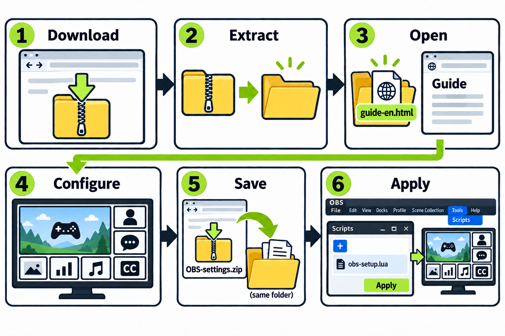

# ALO4OBS

Auto Layout Overlay for Open Broadcaster Software

**[Open the web settings editor](https://kmg200164.github.io/ALO4OBS/)** · [Setup guide](https://kmg200164.github.io/ALO4OBS/guide-en) · [What's new](CHANGELOG.md)

Arrange your stream in the browser, then download **one Lua file** and apply it in OBS. Choose **Bento** for separate panels or **Overlap** for panels above a full-screen Main source.

## How to start

1. Open **[ALO4OBS settings](https://kmg200164.github.io/ALO4OBS/)**. Choose a layout or a built-in preset.
2. Select a preview panel and edit its content, size, spacing and colors. Panel images/videos, background images, web widgets and existing OBS sources remain supported.
3. Click **Download Lua**. Save `script-bento.lua` or `script-overlap.lua` in a permanent, writable folder.
4. In OBS, open **Tools → Scripts → +**, add the Lua, select the original sources and press **Apply saved settings / Auto layout**. For uploaded local images/videos, select their original files in the script's **Local file** fields. Originals are not embedded in Lua.
5. Check the **ALO4OBS · BENTO** or **ALO4OBS · OVERLAP** scene in OBS before using it on stream.

Use **OBS Studio 30.1 or newer**, Browser Source, Tools → Scripts and a **1920 × 1080 base canvas**. The browser preview shows layout and uploaded media; inspect actual captures, cameras and web widgets in OBS.

## Continue editing

Settings and selected media save automatically in the **same browser on the same computer**. Keep the downloaded Lua as a portable settings preset. Use **Import Lua** to restore the settings panel and both stored layout geometries in another browser. Select original local files again for their previews and OBS connections.

**Undo preset** restores the state before the last preset application. Cleared browser storage cannot restore automatically. Personal Lua files can contain private widget URLs; keep them private. Import reads settings data without executing imported Lua or uploading it to a server.

Later edits reach OBS after downloading the updated Lua, reloading its script entry, checking source/file selections and applying again. OBS prepares an internal rendering folder beside the Lua; retain it after Apply. Source selections belong to the OBS script entry, so a new script path or computer may require reselecting them.

Overlap live blur requires Composite Blur. Turn **Enable blur** off to use the layout without that plugin. The **Overlap game + camera** preset starts with blur disabled.

## Development and verification

The web editor follows the **[dev branch](https://github.com/kmg200164/ALO4OBS/tree/dev)** and keeps the existing settings.html interface. Pages serves only the verified neutral static build from `gh-pages`; main is not merged or changed by deployment.

Run `python build_site.py` to build `dist/site/`. See [implementation and verification notes](docs/development-0.11.0.md) and [Pages deployment](docs/pages-deployment.md) and [existing UI rules](docs/design-system.md). Windows automated checks cover Lua export/import, browser media restoration and file-copy failure handling. Registration, rendering and native file pickers in the real OBS app, plus macOS/Linux acceptance, remain pending.

Found it useful? [Support continued improvements](https://buymeacoffee.com/kmg200164). Found a bug? [Report it here](https://github.com/kmg200164/ALO4OBS/issues/new?template=feedback.yml).

Legacy 0.10.4 offline ZIP download and instructions

**[Download the previous 0.10.4 offline package](https://github.com/kmg200164/ALO4OBS/raw/refs/heads/main/downloads/ALO4OBS-v0.10.4.zip)**

The following instructions describe the previous ZIP workflow. The web editor above uses one Lua download.

<h2>How to start</h2>

1. Install **OBS Studio 30.1 or newer** with Browser Source and **Tools → Scripts**. Use a **1920 × 1080 base canvas**. The minimum follows the [scene-item API requirements](https://docs.obsproject.com/reference-scenes#c.obs_sceneitem_get_info2); Windows OBS 32.2.2 is the version tested.
2. Extract the **entire distribution ZIP** and open its root **settings.html**. Choose Bento or Overlap.
3. Select a preview panel, choose its content and configure the layout. For OBS sources, create and verify the original capture/camera source in OBS first. For web widgets, use the provider's OBS display URL.
4. Use the **Save as ZIP** button to create your personal **Settings-Bento.zip** or **Settings-Overlap.zip**. The browser download settings determine its destination. Extract that entire ZIP into a permanent folder.
5. In OBS, open **Tools → Scripts → +** and add that folder's **script-bento.lua** or **script-overlap.lua**, matching your layout. If you use both layouts, add both; their names keep them apart in the Scripts list. Select an original OBS source for each panel using OBS-source content, then click **Apply saved settings / Auto layout**.
6. Open the **ALO4OBS · BENTO** or **ALO4OBS · OVERLAP** scene and check the actual capture, camera, widgets and media before using it on stream.

**Bento** blurs its separately configured full-canvas background image or color behind panels. It never uses Main as the panel backdrop. **Overlap** blurs the selected **Main OBS source** and retains the static backdrop while that capture is unavailable. Original capture filters stay unchanged. Only Overlap live blur needs Composite Blur; setting blur to **0** removes that dependency. The HTML preview cannot show live OBS captures.

The personal ZIP contains only `script-bento.lua` or `script-overlap.lua` at its root. Runtime files are grouped under `files/bento/` or `files/overlap/`. Keep the script and its `files/` folder together. Earlier packages using root files or `layouts/` continue to use their original scripts and paths. Keep the Lua script, configuration, masks, assets and runtime files together. Moving only the Lua script breaks its relative paths. The browser preview shows layout and supported HTML content; actual OBS captures must be checked in OBS.

Browser edits do not automatically update OBS. Save and extract a new personal ZIP, update or register its script path, reload the script, check source selections and Apply again. The included Korean, English and Japanese guides contain the full procedure.

Applying an exported layout creates or updates its own OBS scene: `ALO4OBS · BENTO` or `ALO4OBS · OVERLAP`. Apply each type once to create both scenes. Generated sources and runtime files are separated by type; existing `ALO4OBS` scenes are kept unchanged. Download a fresh package and export a new settings ZIP to use this behavior.

<h2>How to update</h2>

Back up your **OBS scene collection**, the **complete old application folder** and every panel's script source selection. Keep the last working version available and use a separate folder for the new distribution.

1. After Apply in the old version, copy its generated **config.js** (from **files/bento/** or **files/overlap/** in type-specific packages) into the new distribution's **files/** folder. Copy its referenced personal **assets/...** media from that same runtime folder while keeping the same relative paths. Keep the new internal scripts, fonts and **config.public.js**. The editor reads config.js; renaming a JSON file is not an import procedure.
2. Open the new settings editor, check the restored values and save a new personal ZIP. Extract the entire personal ZIP into a new permanent folder.
3. Record the source mappings, remove only the old Lua registration, add the new script and **reselect the original sources before Apply**. A new script registration does not inherit old source-selector values.
4. Apply and verify the **ALO4OBS · BENTO** or **ALO4OBS · OVERLAP** scene in OBS before switching to it. Unassigned legacy connection URLs remain visible for reassignment and are retained in saved exports.

Apply reuses the selected **ALO4OBS · BENTO** or **ALO4OBS · OVERLAP** scene and items whose names start with that scene name, and intentionally restores template scene-item transforms. Original source settings and filters are retained. Other scenes are not directly edited, but generated sources/groups reused in them share content changes. A reserved-name collision aborts Apply; inspect the reported conflict instead of blindly deleting sources.

Recovery and legacy OBS Streaming Template migration

For an ALO4OBS update rollback, import the pre-update scene-collection backup into a **separate recovery collection**. Restore the matching old Lua script and **complete old application folder**, then verify original source mappings. Registering the old Lua script alone does not restore generated browser-source paths changed by an update.

For legacy **OBS Streaming Template / OST**, preserve its scene, **OST ·** groups, original sources and complete script folder. Remove only the old script registration. The new script builds a separate type-specific ALO4OBS scene; verify it before switching. There is no automatic OST scene migration or blanket source deletion.

The running script can restore its prior scene layout and config.js after a controlled Apply failure. That transaction snapshot is not a cross-version migration backup, so keep the complete backups above.

<h2>Two layout types</h2>

| | Bento | Overlap |
| --- | --- | --- |
| Arrangement | All panels stay separate | Auxiliary panels sit above full-screen Main |
| Panels | Main, up to 3 Sub and 3 Side panels | Main and up to 15 auxiliary panels across 5 columns |
| Placement | Main/Sub row order and left/right Side position | Fixed columns, automatic stack alignment or manual vertical placement |
| Wider panels | Bento width controls | Wider width switch on columns 1, 3 and 5 |

Switch layouts from the header. Each layout retains its panel content and settings; Main and global appearance are shared. Existing 0.9.1 configurations migrate to Bento. Curated streaming presets remain postponed and are not included in 0.10.1.

<h2>Features</h2>

- Configure a **1920 × 1080** layout with a sticky preview beside the settings. Both work areas stay side by side; narrow settings use one column.
- Select a panel directly in the preview. The panel-settings section remains visible with a selection hint until you choose one.
- Use **OBS sources, web widgets, images or videos** as panel content.
- Adjust panel gap, corners, fill, stroke and shadow globally or per panel. Image URL and uploaded image file are separate fill choices.
- In Overlap, enable or hide fixed columns, choose 1–3 panels per column, and widen columns 1/3/5. Wider columns temporarily hide their occupied neighbors without erasing settings.
- Adjust Overlap height and Y with Auto/Manual switches, numbers, sliders or vertical preview dragging. Applied geometry fits available space while preserving panel order, gaps and a **128 px minimum height**. Feasible manual positions stay fixed; requested values remain saved if rendering must clamp them.
- Toggle the editor-only safety guide to see game-UI warning areas. It is not broadcast and does not block placement; its usefulness depends on the game.
- Export a portable **Settings-Bento.zip** or **Settings-Overlap.zip** containing settings, masks and selected media. Hidden panels and both layout snapshots stay saved.
- Use **Korean, English or Japanese**, with localized guides and icon-button tooltips, dark/light modes and ten UI color themes. UI themes do not alter broadcast colors or media.
- Free MIT-licensed code, with no required account or subscription.

<h2>Verification</h2>

0.10.2 export correction passed Bento → Overlap → Bento downloads and extraction through the Windows compressed-folder engine, with every extracted file matching its ZIP entry. The native save picker is no longer used.

0.10.1 correction checks passed **288 Node tests**, **35 Python checks**, **24 browser conditions** (Bento/Overlap, Korean/English/Japanese, light/dark, 768/1920 px), sequential Bento → Overlap → Bento downloads and **six real Apply calls** in isolated Windows OBS 32.2.2. Header navigation and editing context were retained; exported archive names matched their settings and runtime paths. See [0.10.1 verification](docs/release-readiness-0.10.1.md).

Historical 0.10.0 checks passed **305 tests over HTTP and 305 with direct file opening**, **35 Python checks**, a **96-condition language/theme/layout/width matrix**, **139 height-control UI states** and **20,000 generated geometry configurations**. An isolated Windows **OBS 32.2.2** run passed **52 Apply calls and 2,164 assertions**, including a controlled internal failure, rollback and successful reapplication. All **484 production OBS configuration file hashes** remained unchanged.

These checks use synthetic OBS sources. macOS, real camera/capture devices, authenticated personal widgets and the native save-dialog flow remain unverified. The original intermittent native mutex crash has not been uniquely attributed; repeated-Apply success does not certify every plugin/device combination. See [release verification and remaining boundaries](docs/release-readiness-0.10.0.md).

<h2>FAQ</h2>

Do uploaded files stay after reopening?

They can stay in the same browser and page origin. Clearing browser data, changing browsers, moving files or direct-file restrictions can remove access. Save Settings-Bento.zip / Settings-Overlap.zip for a portable copy.

Can I use any web page or media URL?

Use a provider's HTTP(S) widget/display URL or a direct media URL. Management and watch pages do not automatically become widgets or playable media. Use assets you have permission to share.

<h2>Privacy and license</h2>

Keep personal **config.js**, **obs-settings.json** and **Settings-Bento.zip** or **Settings-Overlap.zip** private: they may contain widget tokens. Hide personal widget links and stream keys in bug-report screenshots.

Code: [MIT](LICENSE), copyright 2026 KMG. Inter, Lucide and figma-squircle retain their own terms; see [third-party notices](template/assets/THIRD-PARTY-NOTICES.md).

KMG directs the product, design, requirements and real-use evaluation. Code was implemented with [OpenAI Codex](https://openai.com/codex/) through vibe coding.

Older [0.10.1](https://github.com/kmg200164/ALO4OBS/raw/refs/heads/main/downloads/ALO4OBS-v0.10.1.zip), [0.10.0](https://github.com/kmg200164/ALO4OBS/raw/refs/heads/main/downloads/ALO4OBS-v0.10.0.zip), [0.9.1](https://github.com/kmg200164/ALO4OBS/raw/refs/heads/main/downloads/ALO4OBS-v0.9.1.zip) and [0.9.0](https://github.com/kmg200164/ALO4OBS/raw/refs/heads/main/downloads/ALO4OBS-v0.9.0.zip) distribution archives remain unchanged. [Change log](CHANGELOG.md) · [Historical QA](docs/QA.md)

<h2>Documentation language</h2>

Project documentation, including README files, changelogs, QA records, work reports, development guidance and concept-explanation comments, is canonical in English. Localized product UI and Korean/Japanese user guides remain translated and consistent with the English guide.

0.10.3 restores retained uploaded media after moving the editor folder within the same browser origin. Missing or browser-deleted file bytes still require selecting the file again; saved settings are preserved.

### Bundled Composite Blur installation

The three installation helpers are beside settings.html at the top level of the extracted ZIP. Official Composite Blur packages, matching source and license notices remain under `files/plugin/`. Bento uses its separate background image/color without this plugin; Overlap live blur uses Composite Blur.

1. Extract the entire distribution ZIP.
2. Close OBS.
3. On Windows, run `composite-blur-install.cmd` once.
4. Reopen OBS.

The Windows helper installs the plugin and opens the HTML editor. You do not need to run it every time OBS starts. Configuring the HTML layout, saving/extracting a personal ZIP, registering its Lua and clicking Apply are separate steps; installing the plugin does not configure the layout.

The implemented helpers select official packages for OBS 30–33: Windows x64 uses Legacy for 30–32 and modern for 33. The bundled macOS universal helper is `composite-blur-install.command`; the native Debian/Ubuntu amd64 helper is `composite-blur-install.sh`. macOS and Linux helpers open their OS installer for user review of permissions and dependencies. They do not automatically approve prompts or change security settings.

Actual installation was verified on Windows OBS 32. Windows OBS 30/31/33 selection and macOS/Linux helper behavior were tested with command stubs, not installations on those systems. OBS 33 portable installation and Flatpak offline installation are not supported by these helpers. See [plugin support and verification](docs/PLUGIN-SUPPORT.md). Installer scope is separate from HTML/Lua compatibility.

